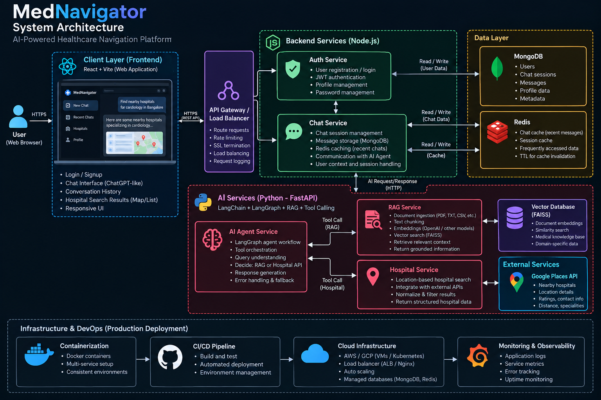

# MedNavigator
### AI-Powered Healthcare Navigation Platform

MedNavigator is an AI-powered healthcare navigation platform designed to help users understand healthcare information, retrieve relevant medical knowledge, and discover nearby hospitals through a conversational interface.

The project combines a microservices-based application backend with an AI orchestration layer. The AI layer uses retrieval-augmented generation (RAG) and tool calling to retrieve grounded information from a medical knowledge base and obtain location-based hospital information when required.

> **Project scope:** MedNavigator is a healthcare information and navigation application. It is not a substitute for a qualified healthcare professional, medical diagnosis, or emergency services. AI-generated information should be treated as informational and independently verified.

---

## Contents

- [Overview](#overview)
- [Key Features](#key-features)
- [System Architecture](#system-architecture)
- [Architecture and Service Responsibilities](#architecture-and-service-responsibilities)
- [AI Orchestration and Request Lifecycle](#ai-orchestration-and-request-lifecycle)
- [Data and Storage Architecture](#data-and-storage-architecture)
- [Technology Stack](#technology-stack)
- [Repository Structure](#repository-structure)
- [Getting Started](#getting-started)
- [Configuration](#configuration)
- [API Overview](#api-overview)
- [Running the Services](#running-the-services)
- [Containerization and Deployment](#containerization-and-deployment)
- [Security and Reliability](#security-and-reliability)
- [Engineering Considerations](#engineering-considerations)
- [Roadmap](#roadmap)
- [Contributing](#contributing)
- [Disclaimer](#disclaimer)

---

## Overview

Healthcare information is often distributed across documents, websites, and service providers. Finding relevant information and identifying nearby healthcare facilities can require users to navigate multiple sources.

MedNavigator addresses this problem through a unified application that brings together:

- **Conversational interaction:** A chat-based interface for submitting healthcare-related queries.
- **Knowledge retrieval:** A RAG pipeline that retrieves relevant passages from an indexed medical knowledge base.
- **Agentic orchestration:** An AI agent that interprets a query and decides which capability should handle it.
- **Hospital discovery:** A location-aware hospital search capability backed by an external places service.
- **Conversation management:** User authentication, chat sessions, message persistence, and recent conversation retrieval.

The application is organized into independently deployable services so that application functionality, AI orchestration, knowledge retrieval, and hospital discovery can be developed and maintained separately.

## Key Features

### Conversational healthcare interface
- Chat-oriented user experience.
- Create and manage conversation sessions.
- Retrieve recent conversations and message history.
- Responsive web application experience.

### Authentication and user management
- User registration and login.
- JWT-based authentication.
- Profile and account-related operations.
- Protected application routes and user-scoped data access.

### AI-powered query handling
- Natural-language query understanding.
- LangGraph-based agent workflow.
- Tool selection and orchestration.
- Retrieval of relevant context from the medical knowledge base.
- Response generation using an LLM.
- Error handling and fallback behavior.

### Retrieval-Augmented Generation (RAG)
- Ingestion of supported knowledge-base documents, including PDF, TXT, CSV, and other configured formats.
- Document processing and text chunking.
- Embedding generation.
- FAISS-based vector indexing and similarity search.
- Retrieval of relevant context for grounded responses.

### Hospital discovery
- Location-based hospital search.
- Integration with Google Places API.
- Structured hospital results, including available location and place details.
- Support for presenting hospital results in the client application.

### Performance-oriented storage
- MongoDB for persistent application data.
- Redis for frequently accessed and recent data.
- Cache expiration using TTL.
- Separation of persistent storage from temporary cache data.

---

## System Architecture

MedNavigator follows a layered, service-oriented architecture. The frontend communicates with the Node.js application backend, while the chat service communicates with the Python-based AI services for query processing.

The AI agent can invoke the RAG service or Hospital service depending on the user's query. These services return structured information to the agent, which prepares a response for the chat service.

### Complete architecture diagram



*The diagram illustrates the application layers, service boundaries, data stores, AI integrations, external services, and the intended infrastructure/deployment layer.*

### Architecture at a glance

| Layer | Responsibility | Main components |
|---|---|---|
| Client | User interaction | React, Vite |
| Application backend | Authentication, chat and API handling | Node.js services |
| AI services | Agent orchestration and knowledge retrieval | Python, FastAPI, LangChain, LangGraph |
| Data | Persistent and cached application data | MongoDB, Redis |
| Vector retrieval | Semantic retrieval from indexed documents | FAISS |
| External integration | Location and hospital information | Google Places API |
| Infrastructure | Packaging, deployment and operations | Docker and cloud infrastructure |

---

## Architecture and Service Responsibilities

The backend is divided into services with focused responsibilities. This separation keeps application concerns independent from AI processing and external integrations.

### 1. Authentication Service

**Technology:** Node.js

Responsible for user identity and authentication.

Responsibilities:
- User registration and login.
- Password management.
- JWT generation and validation.
- Authentication-related profile operations.
- Secure access to protected application functionality.

### 2. Chat Service

**Technology:** Node.js

Acts as the application-facing entry point for conversational functionality and coordinates communication with the AI layer.

Responsibilities:
- Create and manage chat sessions.
- Store and retrieve messages.
- Maintain user-specific conversation history.
- Communicate with the AI Agent Service.
- Pass the current query and relevant conversation context to the AI layer.
- Return the generated response to the frontend.
- Use Redis to cache frequently accessed chat data.

### 3. AI Agent Service

**Technology:** Python, FastAPI, LangChain, LangGraph

Acts as the AI orchestration boundary between the Chat Service and the domain-specific AI tools.

Responsibilities:
- Receive the user's query and relevant conversation context.
- Understand the intent of the query.
- Execute the agent workflow using LangGraph.
- Decide whether RAG retrieval or hospital discovery is appropriate.
- Invoke the relevant service through tool calling.
- Use retrieved information when generating a response.
- Handle tool failures and fallback scenarios.
- Return the generated response to the Chat Service.

The agent is designed to coordinate specialized capabilities rather than placing every operation inside a single AI service.

### 4. RAG Service

**Technology:** Python, FastAPI, embeddings, FAISS

Provides semantic search over the configured medical knowledge base.

Responsibilities:
- Load supported knowledge-base documents.
- Extract and process document text.
- Split documents into manageable chunks.
- Generate vector embeddings.
- Build and query the FAISS vector index.
- Retrieve relevant document chunks for a query.
- Return retrieved context to the AI Agent Service.

The RAG service provides the retrieval component. The AI Agent Service uses the retrieved context as part of its response-generation workflow.

### 5. Hospital Service

**Technology:** Python, FastAPI, Google Places API

Provides location-based hospital discovery.

Responsibilities:
- Accept location and search parameters.
- Integrate with the external places provider.
- Retrieve nearby hospital information.
- Normalize and filter provider results.
- Return structured hospital data to the AI Agent Service.

The AI agent can invoke this service when a query requires nearby hospital information.

The Hospital Service is shown in the Python/FastAPI AI services layer in the supplied architecture diagram. Keep its actual route and request schema consistent with the implementation and the AI Agent Service configuration.

---

## AI Orchestration and Request Lifecycle

The AI workflow separates intent handling, tool execution, retrieval, and response generation.

### High-level request flow

1. A user submits a message through the React application.
2. The frontend sends the request to the Node.js Chat Service.
3. The Chat Service loads the relevant user and conversation context.
4. The Chat Service sends the query and context to the AI Agent Service.
5. The AI agent processes the query through its LangGraph workflow.
6. Based on the query, the agent can invoke:
   - **RAG Service** to retrieve relevant information from the indexed knowledge base.
   - **Hospital Service** to retrieve nearby hospital information.
7. The selected tool returns its result to the AI Agent Service.
8. The agent uses the available information to generate a response.
9. The response is returned to the Chat Service.
10. The Chat Service persists the conversation data and returns the response to the frontend.
11. The frontend displays the response to the user.

### RAG execution flow

```text
User Query
    |
    v
Chat Service
    |
    v
AI Agent Service
    |
    v
LangGraph Agent Workflow
    |
    v
RAG Tool Invocation
    |
    v
RAG Service
    |
    +--> Query Embedding
    |
    +--> FAISS Similarity Search
    |
    +--> Relevant Document Chunks
    |
    v
Retrieved Context
    |
    v
AI Agent / LLM
    |
    v
Generated Response
```

### Hospital discovery flow

```text
User Query
    |
    v
Chat Service
    |
    v
AI Agent Service
    |
    v
LangGraph Agent Workflow
    |
    v
Hospital Tool Invocation
    |
    v
Hospital Service
    |
    v
Google Places API
    |
    v
Normalized Hospital Results
    |
    v
AI Agent / LLM
    |
    v
Response to Chat Service
```

### Why use an agent-based design?

The agent-based approach keeps query interpretation and tool selection separate from the underlying services.

- The agent decides which capability is relevant to the query.
- RAG and hospital discovery remain independently maintainable.
- New tools can be introduced without moving their implementation into the Chat Service.
- Tool errors can be handled at the orchestration boundary.
- The same AI orchestration layer can coordinate multiple domain-specific services.

---

## Data and Storage Architecture

### MongoDB — persistent storage

MongoDB is used for persistent application data, including:

- User records.
- Chat sessions.
- Messages.
- Profile-related data.
- Conversation metadata.

Chat data is associated with the relevant user and conversation so that history can be retrieved in the correct context.

### Redis — caching layer

Redis is used to reduce repeated database reads and improve access to frequently requested data.

Potential cached data includes:
- Recent conversations.
- Frequently accessed session data.
- Recent message data.
- Other frequently accessed application data.

A cache-aside approach can be used:

1. Check Redis for the requested data.
2. If the data exists, return the cached value.
3. If it does not exist, fetch the data from MongoDB.
4. Store the retrieved data in Redis with an appropriate TTL.
5. Return the data to the application.

Cache invalidation and expiration should be considered whenever the underlying data changes.

### FAISS — vector search

FAISS is used by the RAG service for vector similarity search.

The retrieval pipeline consists of:
1. Document ingestion.
2. Text extraction.
3. Text chunking.
4. Embedding generation.
5. Vector indexing.
6. Similarity search.
7. Retrieval of relevant context.

The FAISS index supports semantic retrieval from the configured knowledge base.

---

## Technology Stack

| Category | Technologies |
|---|---|
| Frontend | React, Vite |
| Application backend | Node.js |
| Backend framework | Express.js / configured Node.js framework |
| AI service framework | Python, FastAPI |
| AI orchestration | LangChain, LangGraph |
| LLM integration | Configurable LLM provider (including Groq in the development configuration) |
| Embeddings | OpenAI embeddings / configured embedding provider |
| Vector database | FAISS |
| Primary database | MongoDB |
| Cache | Redis |
| External integration | Google Places API |
| Authentication | JWT |
| Containerization | Docker |
| Version control | Git, GitHub |
| Cloud / deployment target | AWS or GCP, depending on deployment configuration |

*The table describes the technologies and integrations used or represented in the project architecture. The exact provider and deployment configuration are environment-dependent.*

---

## Repository Structure

MedNavigator is maintained as a monorepo so that its related services and frontend can be versioned together.

A logical high-level structure is:

```text
MedNavigator/
│
├── frontend/                 # React + Vite application
│
├── auth-service/              # Authentication and user management
│
├── chat-service/              # Chat sessions, messages and AI communication
│
├── ai-agent-service/          # Python AI orchestration service
│
├── rag-service/               # Document ingestion and vector retrieval
│
├── hospital-service/          # Hospital discovery integration
│
├── assets/
│   └── mednavigator-system-architecture.png
│
├── docker-compose.yml         # If using a root-level Compose configuration
├── .gitignore
└── README.md
```

This is a logical reference layout. Preserve the actual directory names and files in the repository if they differ; update this section to match the checked-in structure.

---

## Getting Started

### Prerequisites

Install the tools required by the services you intend to run:

- Git
- Node.js and npm
- Python 3
- MongoDB
- Redis
- Docker and Docker Compose (if using containerized execution)
- API credentials for the configured LLM, embedding, and Google Places providers

Check the installed versions:

```bash
git --version
node --version
npm --version
python --version
docker --version
docker compose version
```

### Clone the repository

```bash
git clone <YOUR_GITHUB_REPOSITORY_URL>
cd MedNavigator
```

### Install dependencies

Install Node.js dependencies in the Node.js services and the frontend:

```bash
cd auth-service
npm install
cd ..

cd chat-service
npm install
cd ..

cd frontend
npm install
cd ..
```

For each Python service, create an isolated virtual environment and install its declared dependencies:

```bash
cd ai-agent-service
python -m venv .venv
```

Activate the environment:

**macOS / Linux**
```bash
source .venv/bin/activate
```

**Windows PowerShell**
```powershell
.venv\Scripts\Activate.ps1
```

Install the dependencies declared by that service:

```bash
pip install -r requirements.txt
```

Repeat the Python environment setup for `rag-service` and `hospital-service`.

> These commands assume the named directories and dependency manifests exist. Use each service's actual package manager, dependency file, and start script where they differ.

---

## Configuration

Each service should maintain its own environment configuration. Keep real credentials in local `.env` files or a secrets manager; never commit them to Git.

### Example configuration categories

| Service | Configuration | Purpose |
|---|---|---|
| Auth Service | MongoDB connection, JWT secret, port | Authentication and user persistence |
| Chat Service | MongoDB connection, Redis URL, AI Agent URL, port | Chat persistence, caching and AI communication |
| AI Agent Service | LLM provider, model, API key, RAG URL, Hospital URL | Agent orchestration and tool configuration |
| RAG Service | Embedding provider, API key, index/document paths | Document retrieval and vector search |
| Hospital Service | Google Places API key, provider settings, port | Location-based hospital search |
| Frontend | Backend API base URL | Communication with the application backend |

### AI Agent Service configuration

The development configuration has used the following settings:

```env
LLM_PROVIDER=groq
LLM_MODEL=openai/gpt-oss-20b

RAG_SERVICE_URL=http://localhost:8000
RAG_SEARCH_PATH=/search

HOSPITAL_SERVICE_URL=http://localhost:5001
HOSPITAL_NEARBY_PATH=/hospitals/nearby
```

These are development examples, not production credentials or a guarantee that every service currently uses these exact values. Confirm the configured paths and ports against the service code before running the application.

### Environment variable guidelines

- Maintain an `.env.example` file for each service.
- Do not commit `.env` files containing secrets.
- Keep API keys and JWT secrets out of source code.
- Use separate development and production configurations.
- Validate required environment variables when a service starts.
- Use strong, unique secrets in production.
- Restrict CORS origins to trusted frontend origins.

---

## API Overview

The application exposes service-specific APIs rather than placing every capability behind a single service implementation.

| Service | API responsibility |
|---|---|
| Auth Service | Registration, login, authentication and profile operations |
| Chat Service | Chat session creation, message submission, history and conversation management |
| AI Agent Service | Query processing, agent execution and tool orchestration |
| RAG Service | Knowledge-base search and retrieval |
| Hospital Service | Nearby hospital search and structured hospital results |

### RAG search endpoint

The RAG service includes a search route:

```http
POST /search
```

The endpoint accepts a search request and returns retrieved results in the service's response schema.

### Hospital search

The Hospital Service exposes the hospital-search capability used by the AI agent. Its exact HTTP method, request schema, and route should be taken from the current service implementation and kept consistent with the AI Agent Service configuration.

### API documentation recommendations

For maintainability, document each endpoint with:
- HTTP method and route.
- Authentication requirements.
- Request body or query parameters.
- Response schema.
- Validation rules.
- Error response format.
- Example request and response.

---

## Running the Services

Start the infrastructure dependencies first:

- MongoDB
- Redis

Then start the application services in the following logical order:

1. Auth Service.
2. RAG Service.
3. Hospital Service.
4. AI Agent Service.
5. Chat Service.
6. React frontend.

The AI Agent Service must be able to reach the RAG and Hospital services using their configured base URLs. The Chat Service must be able to reach the AI Agent Service.

For local development, verify that:
- Each service is listening on its configured port.
- Environment variables are loaded correctly.
- MongoDB and Redis are reachable.
- Internal service URLs use the correct hostnames and ports.
- The frontend points to the correct backend API URL.
- External API credentials are valid.

The exact start commands depend on the scripts and ASGI entry points defined in each service. Use the corresponding `package.json` scripts or FastAPI application module rather than assuming a common command across services.

---

## Containerization and Deployment

Docker can be used to package services with their runtime dependencies and provide consistent environments across development and deployment.

A containerized setup can include:
- Frontend.
- Node.js application services.
- Python AI services.
- MongoDB.
- Redis.

Docker Compose can coordinate local multi-container execution where a Compose configuration is maintained.

### Deployment architecture

The infrastructure layer represented in the architecture diagram includes:

- **Containerization:** Docker-based service packaging.
- **CI/CD:** Automated build, test and deployment workflows.
- **Cloud infrastructure:** AWS or GCP compute and networking services.
- **Load balancing:** An application load balancer or reverse proxy where required.
- **Managed data services:** Managed MongoDB and Redis deployments where appropriate.
- **Monitoring:** Application logs, service metrics, error tracking and uptime monitoring.

These are deployment architecture capabilities and targets. Do not interpret every item in the diagram as already deployed or automated in the current repository.

### Production deployment considerations

- Use a separate configuration for each environment.
- Store credentials in a managed secrets service.
- Configure health checks for each service.
- Apply resource limits to containers.
- Configure service-to-service networking.
- Use HTTPS for external traffic.
- Set up centralized logging and monitoring.
- Back up persistent data.
- Define deployment and rollback procedures.

---

## Security and Reliability

Security and reliability are important because the platform handles user accounts, conversations, and healthcare-related information.

Recommended controls include:

### Authentication and authorization
- Validate JWTs on protected routes.
- Enforce user-level access to sessions and messages.
- Hash passwords using an appropriate password-hashing algorithm.
- Keep signing secrets outside the repository.
- Apply authorization checks at the service boundary.

### API security
- Validate and sanitize incoming requests.
- Apply rate limiting to public-facing endpoints.
- Configure CORS with explicit trusted origins.
- Use HTTPS in deployed environments.
- Avoid exposing internal service credentials or stack traces.

### Data protection
- Avoid logging passwords, tokens, API keys, or unnecessary personal information.
- Restrict database access.
- Use secure secret management.
- Define data retention and deletion policies.
- Protect backups and persistent storage.

### AI and healthcare safeguards
- Treat retrieved documents and external tool responses as untrusted input.
- Do not allow retrieved content to override system-level safety instructions.
- Handle missing, conflicting, or low-confidence retrieval results carefully.
- Clearly distinguish informational content from professional medical advice.
- Direct users experiencing a medical emergency to local emergency services rather than relying on an AI response.

---

## Engineering Considerations

The architecture is designed around several software engineering principles:

| Principle | Application in MedNavigator |
|---|---|
| Separation of concerns | Authentication, chat, AI orchestration, RAG and hospital discovery have separate service responsibilities. |
| Modularity | Domain-specific capabilities are maintained behind service boundaries. |
| Scalability | Services can be scaled independently according to workload. |
| Caching | Redis can reduce repeated reads for frequently accessed chat data. |
| Retrieval grounding | RAG retrieves relevant knowledge-base context before response generation. |
| Extensibility | The agent can coordinate additional tools as new capabilities are introduced. |
| Maintainability | Each service can be developed, tested and configured independently. |
| Fault handling | The AI orchestration layer provides a boundary for tool errors and fallback behavior. |

---

## Roadmap

Potential areas for future development include:

- [ ] Add comprehensive unit and integration test coverage across services.
- [ ] Add API contract documentation and schema validation.
- [ ] Introduce centralized structured logging and distributed tracing.
- [ ] Add service health checks and readiness probes.
- [ ] Implement CI/CD workflows for automated testing and deployment.
- [ ] Improve RAG evaluation, retrieval quality measurement and source attribution.
- [ ] Add document versioning and a repeatable vector-index update pipeline.
- [ ] Add stronger observability for agent decisions and tool execution.
- [ ] Improve cache invalidation and performance testing.
- [ ] Deploy the complete application to a cloud environment.
- [ ] Add end-to-end testing for key user journeys.

---

## Contributing

Contributions and improvements are welcome.

A typical contribution workflow:

1. Create a feature branch.
2. Make changes within the relevant service.
3. Run the applicable tests and checks.
4. Verify that environment files and secrets are not included.
5. Commit changes with a descriptive message.
6. Open a pull request describing the change.

Keep service-specific changes isolated where possible and update this README whenever architecture, configuration, or service responsibilities change.

---

## Disclaimer

MedNavigator is a software engineering project intended to demonstrate healthcare information retrieval, AI orchestration, and hospital navigation capabilities. It does not provide a medical diagnosis, prescribe treatment, or replace consultation with a qualified healthcare professional.

The accuracy and completeness of responses depend on the configured language model, indexed knowledge sources, external service availability, and the quality of user-provided information. Users should verify important healthcare decisions with qualified professionals.
